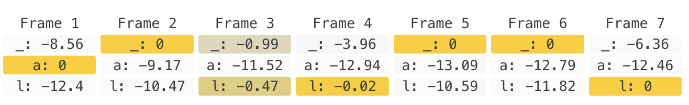

import BenchChart from "../src/components/BenchChart"
import QuartzSpin from "./images/quartz-spin.mp4"

export const whisper = [
  {
    label: "tiny.en, 1 processor",
    value: 40,
    time: "35.78 s",
    note: "tiny.en is the recommended model, and only works for English",
  },
  {
    label: "tiny.en, 8 processors",
    value: 220,
    time: "6.53 s",
    note: "--processors 8 produces potentially much less accurate results. This is what I was using and used to",
    highlight: true,
  },
  {
    label: "large-v3-turbo, 1 processor",
    value: 13.4,
    time: "1m 46.7s",
    note: "The recommended non-English model, best tradeoff between performance and accuracy",
  },
  { label: "large-v3-turbo, 8 processors", value: 28.9, time: "49.9 s" },
  {
    label: "large-v3-turbo on Groq",
    value: 216,
    note: "Just going off of their docs, they aren't giving out API keys anymore",
    estimate: true,
  },
]

export const mmsWebgpu = [
  {
    label: "Whisper tiny.en, 1 processor",
    value: 40,
    time: "35.78 s",
    note: "For reference",
  },
  {
    label: "Whisper tiny.en, 8 processors",
    value: 220,
    time: "6.53 s",
    note: "For reference",
  },
  {
    label: "MMS-300m, WebGPU, fp32",
    value: 41.3,
    time: "34.80 s",
    highlight: true,
  },
]

export const mmsFp16 = [
  { label: "MMS-300m, WebGPU, fp32", value: 41.3, time: "34.80 s" },
  {
    label: "MMS-300m, WebGPU, fp16",
    value: 65.1,
    time: "22.06 s",
    highlight: true,
  },
]

export const mmsMlxBuggy = [
  { label: "MMS-300m, WebGPU, fp32", value: 41.3, time: "34.80 s" },
  { label: "MMS-300m, WebGPU, fp16", value: 65.1, time: "22.06 s" },
  {
    label: "MMS-300m, MLX, fp16",
    value: 672,
    time: "2.13 s",
    highlight: true,
  },
]

export const mmsMlx = [
  { label: "MMS-300m, WebGPU, fp32", value: 41.3, time: "34.80 s" },
  { label: "MMS-300m, WebGPU, fp16", value: 65.1, time: "22.06 s" },
  {
    label: "MMS-300m, MLX, fp16",
    value: 177,
    time: "8.11 s",
    note: "After the node-swift fix",
    highlight: true,
  },
]

export const modelSizes = [
  {
    label: "Whisper tiny, 1 language",
    value: 39,
    note: "Only English is really acceptable",
  },
  { label: "Whisper large-v3-turbo, 30+ languages", value: 750 },
  { label: "MMS, 100+ languages", value: 300 },
  { label: "QuartzNet 15x5, 1* language", value: 18.9, highlight: true },
]

export const quartzRaw = [
  {
    label: "MMS-300m, WebGPU, fp16",
    value: 62,
    time: "~24 min",
    note: "The previous default on non-Apple GPUs",
  },
  {
    label: "MMS-300m, MLX, fp16",
    value: 170,
    time: "8m 31s",
    note: "",
  },
  {
    label: "QuartzNet ONNX, WebGPU, fp32",
    value: 197,
    time: "7m 31s",
    highlight: true,
    note: "Raw export, TypeScript mel front end",
  },
  {
    label: "QuartzNet ONNX, CPU, fp32",
    value: 88,
    time: "~17 min",
    highlight: true,
    note: "Raw export, TypeScript mel front end.",
  },
]

export const quartzMlxFirst = [
  {
    label: "MMS-300m, MLX, fp16",
    value: 168,
    time: "8m 47s",
    note: "",
  },
  {
    label: "QuartzNet ONNX, WebGPU, fp32",
    value: 197,
    time: "7m 31s",
    note: "Raw export",
  },
  {
    label: "QuartzNet MLX, fp16",
    value: 1293,
    time: "1m 09s",
    note: "38 s chunks, batch 2",
    highlight: true,
  },
]

export const staircase = [
  { label: "10 s chunks", value: 673, note: "FFT length 1024" },
  { label: "15 s chunks", value: 854, note: "FFT length 1024" },
  {
    label: "18 s chunks",
    value: 853,
    note: "FFT length 1024, top of the band",
  },
  {
    label: "20 s chunks",
    value: 632,
    note: "FFT length 2048, bottom of the band",
  },
  { label: "25 s chunks (old default)", value: 688, note: "FFT length 2048" },
  { label: "30 s chunks", value: 809, note: "FFT length 2048" },
  {
    label: "38 s chunks (new default)",
    value: 853,
    note: "FFT length 2048, top of the band",
    highlight: true,
  },
  {
    label: "40 s chunks",
    value: 617,
    note: "FFT length 4096, every layer steps up",
  },
]

export const mlxLadder = [
  // {
  //   label: "Starting point, QuartzNet on MLX",
  //   value: 299,
  //   time: "4m 57s",
  //   note: "fp32, 25 s chunks, one chunk per call",
  // },
  {
    label: "Starting point QuartzNet MLX",
    value: 858,
    time: "1m 43s",
    note: "Specific model implementation detail",
  },
  {
    label: "+ 38 s chunks",
    value: 987,
    time: "1m 30s",
    note: "See below, 38s chunks are optimal for this model.",
  },
  {
    label: "+ batch 2",
    value: 1102,
    time: "1m 21s",
    note: "Basically routing 2 chunks per call through the model at once, so that there's less of a chance of the model being idle in between calls",
  },
  {
    label: "+ fp16",
    value: 1293,
    time: "1m 09s",
    note: "Quantization!",
    highlight: true,
  },
]

export const onnxLadder = [
  {
    label: "WebGPU, raw export",
    value: 197,
    time: "7m 31s",
    note: "TypeScript mel front end, fp32, 25 s chunks",
  },
  {
    label: "WebGPU, mel front end in the graph",
    value: 496,
    time: "2m 59s",
    note: "fp32, 25 s chunks, one chunk per call",
  },
  { label: "+ fp16", value: 572, time: "2m 35s", note: "One chunk per call" },
  {
    label: "+ 38 s chunks, batch 2",
    value: 644,
    time: "2m 18s",
    note: "",
    highlight: true,
  },
  {
    label: "CPU, raw export",
    value: 88,
    time: "~17 min",
    note: "TypeScript mel front end.",
    estimate: true,
  },
  {
    label: "CPU, mel front end in the graph",
    value: 107,
    time: "~14 min",
    note: "fp32, batch 1.",
    estimate: true,
  },
]

export const everything = [
  { label: "Whisper tiny.en, p=1", value: 40, note: "24 minute chapter only" },
  {
    label: "Whisper tiny.en, p=8",
    value: 220,
    note: "24 minute chapter only, less accurate",
  },
  {
    label: "Whisper large-v3-turbo, p=8",
    value: 28.9,
    note: "24 minute chapter only",
  },
  {
    label: "(New) MMS-300m, WebGPU",
    value: 62,
    time: "~24 min",
    note: "fp16. Measured on the 6.3 hour test book",
    // estimate: true,
    highlight: true,
  },
  { label: "(New) MMS-300m, MLX", value: 168, time: "8m 47s", note: "fp16" },
  {
    label: "(New) QuartzNet, CPU",
    value: 107,
    time: "~14 min",
    note: "ONNX, fp32. Measured on the 6.3 hour test book",
    highlight: true,
    // estimate: true,
  },
  {
    label: "(New) QuartzNet, WebGPU",
    value: 644,
    time: "2m 18s",
    note: "ONNX, fp16, batch 2",
    highlight: true,
  },
  {
    label: "(New) QuartzNet, MLX",
    value: 1293,
    time: "1m 09s",
    note: "fp16, batch 2",
    // highlight: true,
  },
]

export const gridUpdate = [
  {
    label: "Whole Moby Dick, WebGPU, before",
    value: 644,
    time: "2m 18s",
    note: "44 files",
  },
  {
    label: "Whole Moby Dick, WebGPU, chunk grid",
    value: 725,
    time: "2m 02s",
    note: "",
    highlight: true,
  },
  {
    label: "Bunch of MP3s, MLX, before",
    value: 1095,
    time: "20.7s",
    note: "",
  },
  {
    label: "Bunch of MP3s, MLX, chunk grid",
    value: 1271,
    time: "17.9s",
    note: "",
    highlight: true,
  },
  {
    label: "Single .m4b, MLX, before",
    value: 860,
    time: "21.8s",
    note: "This is what we will be trying to optimize in the future",
  },
  {
    label: "Single .m4b, MLX ",
    value: 1464,
    time: "12.8s",
    note: "This prepares us well for 'no-split' in the future",
    highlight: true,
  },
]

Heya!

Okay I know what you're thinking: "There's a v3??". Yes, sorry, we didn't really
announce it anywhere other than
[our Discord server](https://discord.gg/KhSvFqcrza) (do join!), but if that's
the main thing you take away from this you can install it using the
`v3.0.0-beta` tag! More to follow on that soon!

But don't mind that: we want to talk about our new alignment process!

:::tip[TL;DR]

- We have a new
  [CTC forced alignment pipeline](https://smoores.dev/post/automating_immersive_reading/)
  which produces much more accurate alignments
- That pipeline can use two groups of models, MMS and Quartz/Citrinet
- The Quartz/Citrinet variants can be up to 20 times faster than even the most
  highly optimized versions of the previous Whisper based transcription
- Maybe even faster in the future! Try it out now!!

:::

<BenchChart
  title="Moby Dick transcription speeds"
  unit="x"
  rows={everything}
  caption="The highlighted rows are available now to use!"
/>

{/* truncate */}

Spurred on by
[this MR](https://gitlab.com/storyteller-platform/storyteller/-/merge_requests/576)
from community member [Justus](https://gitlab.com/Just2it), the lead Storyteller
developer, [Shane], recently added a whole new alignment pipeline to
Storyteller!

He already wrote a
[great blog post](https://smoores.dev/post/automating_immersive_reading/) about
how it works, which you should read first!

:::tip[Summary]

... No I'm not going to summarize it here, just read his excellent blog post! It
has animations!

:::

For this article, the only thing you _really_ need to know is that instead of
what Storyteller was using before, namely transcribing the audio directly to
text using e.g. Whisper, we now transcribe the audio to "emissions", which are
20ms frames of probability scores for each of the possible characters in the
alphabet (although we'll get back to that alphabet part). The model that we had
been using is called MMS (Massively Multilingual Speech), developed by Meta
in 2023.



Then we do some complicated math to figure out where this matches up with the
actual chapters in the book, and do some even more complicated math to align
these emissions with the actual words in the book. The result: we can now much
more easily find where in the book the audio is coming from, and the actual
timestamps of the audio within the book are much more accurate (which will allow
us to e.g. do word-level highlighting in the future!). As a bonus: MMS, being
"Massively Multilingual", works with >1000 languages! (didn't even know there
were that many!)

"Okay Thomas", I hear you whimper, "but if that's all so cool and great and
Smoores already wrote a blog post about it, why do I need to sit through your
half-assed attempt to summarize it (which you said you weren't going to do)?!".
Wow okay harsh but fair.

There was one issue with the above, namely: it just wasn't as fast for people
(like me!) who were specifically using their MacBook to do transcriptions. The
previous model we were using, Whisper, specifically the cross platform
[whisper.cpp](https://github.com/ggml-org/whisper.cpp) implementation, had a
bunch of hardware specific optimizations for Apple Silicon (and other hardware)
that are hard to replicate using the cross-platform runtime we use for MMS,
[ONNX](https://onnxruntime.ai/), which you can think of as sort of a generic
middleware for running Machine Learning code that handles executing the same
model on different hardware. By contrast, Whisper.cpp is a specific
implementation of a _single_ model (okay, 2 now, they also support Parakeet)
optimized for different kinds of hardware. Hard to compete with that!

The standard way to measure the speed of an ASR (automatic speech recognition)
process is the Realtime Factor (RTF). This is the amount of time it takes to
transcribe the audio, divided by the total duration of said audio.

$$
RTF = \frac{T_{transcription}}{T_{audio}}
$$

This however almost always gives numbers < 1 (e.g.
$\frac{T_{transcription} = \text{1 hour}}{T_{audio} = \text{20 hours}} = 0.05$
), which is kind of annoying to read. So we will use the opposite of that, call
it $\text{x}RT$. If a 20 hour audiobook takes 1 hour to transcribe, we will say
it's $20\text{x}$.

Anyway, some comparisons. We will use the first chapter of Moby Dick as a
reference point, which is ~24 mintues long. All of these are measured on my
Macbook Pro M1 Max with 64 GB of RAM, full blast, after a run of warmup.

<BenchChart
  title="Whisper.cpp, first chapter of Moby Dick"
  unit="x"
  rows={whisper}
/>

For me, it was specifically that 220x number that I had gotten so used to.

Okay, now let's see ~~Paul Allen's Transcription Model~~ how MMS fares.

<BenchChart
  title="MMS-300m through ONNX, first chapter of Moby Dick"
  unit="x"
  rows={mmsWebgpu}
/>

Oof. While quite decent, especially for it's accuracy, I must admit that in
secret Jess (our lovely product manager) and I were somewhat saddened we had to
give up our very very fast `tiny.en`. What's more: this model drew MUCH more
heavily on the GPU. My M1 Max has quite a lot of spare GPU, so it's still quite
fast (slightly faster than tiny.en p=1), but for Jess, who runs her server on an
M4 Mac Mini, things were looking much more dire.

This is because, due to the specific hardware optimization in Whisper.cpp, it
was running using Apple's
[CoreML](https://developer.apple.com/documentation/coreml) framework, which is
able to split the load between the CPU, GPU, and Neural Engine on Apple Silicon.
In contrast, we run MMS by using ONNX's
[WebGPU Execution Provider](https://onnxruntime.ai/docs/execution-providers/WebGPU-ExecutionProvider.html),
which uses Metal (Apple's equivalent of DirectX/Vulkan), which _only_ runs on
the GPU.

But, this was on the same order of execution speed as `p=1` Whisper, so surely
we could parallelize it a bit right? Right??

No, sadly not. MMS (or ONNX) by default is extremely adapt at using all
available GPU power. Apple is normally extremely loathe to spin up the fans on
Macbooks, to the point where if I want to stress test my laptop I need to run a
separate program to turn up the fans to 100% to get consistent results. When
running MMS on a full book however, wowza, the fans are easily pinned to 80% max
(unheard of!) and GPU is 100% for the full duration of a transcription! There's
really no way to squeeze any more perfomance out of this setup.

...But what if we changed the setup?

## Down the rabbit hole

### FP Quantization

The first thing you may notice in the "Notes" section of the table above is that
`fp32` number. This stands for "floating point 32bits", which means that the
model uses
[32bit floating point numbers](https://en.wikipedia.org/wiki/Single-precision_floating-point_format)
for its calculations, weights, etc. It's the standard size for models and has
the highest precision usually. This _roughly_ means it can reliably store 7
decimal digits with some accuracy.

A common "trick" to make models faster/use less memory is to make it use a lower
precision representation. What if we used `fp16` instead? This will only result
in 3-4 decimal digit precision.

<BenchChart
  title="MMS-300m in fp16, first chapter of Moby Dick"
  unit="x"
  rows={mmsFp16}
/>

Okay okay not bad! You might be worried that we are losing some precision in the
output (those probability values we talked about!), and you would be right, but,
as we will see, the new aligner is so good this basically doesn't matter (the
difference is a few percent anyway).

Theoreticaly we could go _even_ lower to `int8` quantization, which would make
the model weights basically have no significant digits at all. This proved to be
too inaccurate however.

### Hope

So is this all we can squeeze out of MMS? Not quite! Remember when we talked
about `whisper.cpp` being able to leverage CoreML, Apple's specific Machine
Learning platform? Well turns out (confusingly), Apple has _another_ ML platform
called [MLX](https://mlx-framework.org/#community)[^1][^2]. Someone has ported
[MMS (and a whole bunch of other models)](https://github.com/Blaizzy/mlx-audio-swift)
to MLX. Shane ported that to make it work for our needs, so let's see how it
does!

<BenchChart
  title="MMS-300m on MLX, first chapter of Moby Dick"
  unit="x"
  rows={mmsMlxBuggy}
/>

😳 Wowza, that's a spicy ~~meatball~~ model!

Hmm, however, when we tried to align the book with these numbers, there turned
out to be a
[bug in node-swift](https://github.com/kabiroberai/node-swift/pull/60) (which as
I'm writing this has been fixed 4 hours ago!!) that counted only 1/4 of the
bytes coming in. After adjusting for that, we get some more down to earth
numbers

<BenchChart
  title="MMS-300m on MLX, corrected, first chapter of Moby Dick"
  unit="x"
  rows={mmsMlx}
/>

Still excellent!!

A ~~weaker~~ more sensible man would have given up here and accepted this
outcome as the best we could do. And admittedly it's pretty good! However, there
were two things bugging me:

1. This model still churned the hell out of my laptop, getting extremely hot to
   the touch. I knew that, if we wanted to really make this work, we needed to
   put _some_ limiters on it, which would pull down that number considerably.
2. While I had hella success, Jess' Mini was less lucky. While faster, MLX still
   mostly relied on the GPU, which a Mac Mini just does not have that much off.
3. This Apple specific solution was not really generalizable to other platforms.

### Searching for gems

Now fully bitten by optimization fever, I spent a weekend scouring for possible
solutions to speed this thing up. Luckily, the output of MMS isn't super unique,
so I thought "there _must_ be some other CTC model that outputs the same thing?"

Specifically, we need a model that outputs _single character_ probabilities
(ideally in 20ms frames but beggars can't be choosers) in Latin script.

The most obvious place to look is MMS' dad:
[Wav2Vec2](https://huggingface.co/docs/transformers/model_doc/wav2vec2),
developed in 2020 by Meta (then Facebook still). MMS also a model trained using
the Wav2Vec2 framework. Alas, Wav2Vec2 was not a good fit as

1. It was basically as big (~300m params), and therefore roughly as slow
2. It only worked in English!

It only working in one or more specific languages wouldn't be that much of a
dealbreaker (after all Whisper "only" technically works in 100 languages, of
which ~30 have low enough WER (word error rates) to be usable), plus there was
this specific fast path using the `.en` models.

### But finding... Quartz?

After A LOT of digging, I did find _one_ lil model: NVIDIA's
[Quartznet](https://catalog.ngc.nvidia.com/orgs/nvidia/-/models/quartznet15x5/-?_lr=1),
released in Spring 2020. It was much harder to find resources or discussion on
it, possibly because it seems to have been completely overshadowed by Wav2Vec2
releasing shortly after, their papers having ~450 vs ~12000 citations
respectively.

It's impressively tiny! The model we'll be looking at, `QuartzNet-15x5`, only
has 18.9M parameters!

<BenchChart
  title="Model size in parameters"
  unit="M"
  valueHeader="Parameters"
  rows={modelSizes}
/>

<a id="caveat-footnote" href="#caveat">
  \* We'll come back to that...
</a>

For once, bigger number is not better here, as model size closely correlates
with transcription speed.

Okay, cool, let's see how well it does. From now one we'll be benchmarking an
entire book, namely this
[LibriVox recording of Moby Dick](https://librivox.org/moby-dick-by-herman-melville/).
It's ~24 hours and 44 mp3 files, which will provide a slightly more accurate
representation of the... difficulties we'll run into later.

<BenchChart
  title="QuartzNet15x5, straight from the ONNX export, whole Moby Dick"
  unit="x"
  rows={quartzRaw}
  caption=""
/>

Pretty good! Three times faster than MMS using the same settings. But this is
running into the same issue we had with MMS, namely that it's running in this
generic ONNX runtime, which isn't _that_ optimized for Apple Silicon.

Luckily this model is not very complicated. It needs three parts:

- The model weights converted from ONNX to MLX. We already needed to do this for
  MMS and while not trivial, there are many off the shelf solutions
- An MFCC frontend. Something that converts the incoming raw audio samples into
  [mel spectrograms (MFCCs)](https://en.wikipedia.org/wiki/Mel-frequency_cepstrum):
  basically a "human hearing"-optimized representation of the audio in 20ms
  slices
- The model runtime. Given that the model is EXTREMELY simple, it can be
  implemented in 100 lines of swift

Luckily I know a "guy" who's _pretty_ good at one-shotting neural network
implementations, so voila.

Let me just start with the final result:

<BenchChart
  title="QuartzNet15x5 on MLX, whole Moby Dick"
  unit="x"
  rows={quartzMlxFirst}
  caption="MLX Swift port, fp16, 38 second chunks, two chunks per call. Same book, same machine."
/>


I, uhh.... That can't be right. Surely we've just added the same kind of error
we had for the MMS MLX port right?

...

Nope! Those are real numbers baby. Holy shit. As a comparison: just
converting/decoding the source mp3s into raw audio with `ffmpeg`, one file after
the other, takes 40 seconds for this book. The whole transcription took 69
(nice).

That's SO much faster than the ONNX runtime. How?

It tooks quite a lot of steps to get here.

### Progression

#### The size of your Moby Dick chunks matter a lot

Due to Fourier Transform implementation details I don't fully understand, the

<BenchChart
  title="QuartzNet on MLX, Moby Dick"
  unit="x"
  rows={staircase}
  caption=""
/>

(I ran out of energy to write this, see here the result of the progression)

<BenchChart
  title="QuartzNet on MLX, Moby Dick"
  unit="x"
  rows={mlxLadder}
  caption="See table for some explanation"
/>

#### ONNX speedups

Unlike for MLX, the Mel frontend (the thing turning the audio into a
spectrogram) is not implemented in Swift. Instead, it was implemented in
JavaScript, following roughly
[this tutorial](https://haythamfayek.com/2016/04/21/speech-processing-for-machine-learning.html).
However, this was quite slow: the MLX version took 1ms per 25 second chunk, but
the JS version took 86ms!

The solution? Well, the model is doing a bunch of convolutions already... why
not have it do it? The model already had this feature, but it was dropped in the
ONNX export. Later NVIDIA models retain this feature

See for instance this handy-dandy visualization of the original NEMO model:

<a
  href="https://hfviewer.com/RobotsMali/stt-bm-quartznet15x5-v0?utm_source=huggingface&amp;utm_medium=embedded_model_card&amp;utm_campaign=RobotsMali__stt-bm-quartznet15x5-v0_card&amp;utm_content=embedded_card_open_viewer&amp;from=embedded-model-card"
  target="_blank"
  rel="noopener"
>
  
</a>

The reason for that is rather technical: basically ONNX does/did not support the
specific operations needed to have the same kind of frontend as the original
(NEMO) model. We put it back in manually.

<BenchChart
  title="QuartzNet through ONNX, step by step, whole Moby Dick"
  unit="x"
  rows={onnxLadder}
  caption="onnxruntime-node 1.29 on M1 Max. Likely faster on CUDA"
/>

#### Results

And once more, the whole final result table

<BenchChart
  title="QuartzNet on MLX, Moby Dick"
  unit="x"
  rows={everything}
  caption="See table for some explanation"
/>

### Downsides

Remember that <a id="caveat" href="#caveat-footnote">\*</a>?

Unfortunately, QuartzNet is not a very general model. Only the following
languages are supported:

- 🇸🇦 Arabic
- 🇦🇲 Armenian
- Catalan
- 🇬🇧 English
- 🇫🇴 Faroese
- 🇩🇪 German
- 🇫🇷 French
- 🇮🇸 Icelandic
- 🇮🇹 Italian
- 🇯🇵 Japanese
- 🇰🇿 Kazakh
- 🇲🇹 Maltese
- 🇨🇳 Mandarin
- 🇵🇱 Polish
- 🇵🇹 Portuguese
- 🇷🇺 Russian
- 🇪🇸 Spanish

If you pick any other language, we will fall back to using MMS.

We plan on supporting more languages in the future! For that we likely will need
your help to try and fine-tune the English model. Please let us know if you are
interested in helping out on [our Discord](https://discord.gg/KhSvFqcrza).

### Gotta go even faster!

With all these speedups, we are in the incredible position that parts of the
alignment process we used to handwave away as "neglible" compared to inference
time now suddenly start to matter!

There are three things we can still optimize, in each of the steps of the
transcription process (which are, to remind you: transcoding/splitting the audio
-> transcribing the audio -> aligning the audio)

#### Transcoding (to do)

This can at the moment take by far the most amount of time! If you choose to
transcode your books into, say, the extremely well optimized OPUS codec, this
may run up to 10 times _slower_ now than the actual transcription step!

Unfortunately, unless someone invents a way to run audio transcoding on the GPU,
we are stuck with more boring solution, namely: not doing the transcoding at the
same time as aligning.

We will in a future (post v3 stable release) update add the option to transcode
your audiobooks on ingestion. For those of us not particularly picky about the
source format, this can save a ton of space, as an OPUS transcode of a 20hour
AAC encoded .m4b can easily take it from 1gb to 300mb!

Another thing to look forward to is, potentially, not having to duplicate your
audiobooks! Currently the only output for the alignment process is an EPUB 3
with Media Overlays, including all the audio. This will need to be kept on disk
next to your other books, boo!

We will likely offer ways to basically only construct the full EPUB3 at download
time, so you can keep the alignment data separately. Up until now this was too
tricky, as we needed to chop the audio into reasonably sized chunks for Whisper
to be able to process them. Since now the chunks need to be _even_ smaller
(25/38), we needed to find a different way to map from the source audio to the
audio in the book anyway.

No promises on the timeline for this "no-split" version however!

Anyway, being able to "skip"/defer this step could likely more than half your
total alignment time if you don't use the "default" transcoding option. Neat!

#### Batching/decoding (done!)

Early testers mentioned seeing something strange... Their GPU was only showing
roughly 25% utilization! While they were still getting a pretty nice speedup,
wasn't I complaining above that my laptop got so hot I couldn't touch it?

Yes! However, that was only true on Apple Silicon at the time. The default
runtime uses ONNX, which, sadly, seems to be running the model _synchronously_!
That sentence should strike fear into the heart of any JavaScript enthousiast:
JavaScript is a single threaded language, so any synchronous operation will
block any other operation from running on that same thread. While we run the
entire alignment process in a separate thread (a Worker) so that you can still,
like, _actually use_ Storyteller while you are aligning a book, we don't (yet)
run the inference step in a separate thread from everything else.

This wasn't really a problem with the MMS model, since it's relatively
relatively slow and so waiting on the model to finish processing a chunk (which
we need to do anyway) would be the longest part of the transcriptin step anyway.
After obtaining the Quartznet Chaos Emerald however, suddenly the transcription
step is half split between turning the chunk into raw audio (~ a WAV file) and
waiting for the model!

We were basically doing something like this:

```
  track 1  [decode ][model  ]
  track 2                    [decode ][model]
  track 3                                    [decode...
  time --------------------------------------------->
```

Model inference is often done on the GPU, while audio decoding is done on the
CPU, so of course you would think "ah let's just do a bunch of that decoding
while we wait for the model to be done!" Good idea!

I wanted to do something like this, maximize the amount of time the CPU is doing
something useful while the model is busy.

```
  track 1  [decode ][model ]
  track 2           [dec]   [model ]
  track 3                [dec]      [model ]
  track 4                     [dec]         [model ]
  time --------------------------------------------->
```

Unfortunately, I was testing that with our MLX models, which do run
asynchronously meaning they leave some gaps for the CPU to be like "hey btw
there's some stuff i'm done with". With ONNX, no bueno: while we are cleverly
batching the decoding of audio in the background, when we try to push it into
the model, try as we might, we cannot progress the pushing of the decoded audio
chunk into the model, because it's too dang busy!


So instead it turned into this again:

```
  track 1  [decode ][model ]
  track 2                     [dec][model ]
  track 3                                    [dec][model ]
  time --------------------------------------------->
```

But actually _less_ efficient than before, because rather than our simple one at
a time pipeline I was trying to be too clever. We were using
[ffmpeg-stream](https://www.npmjs.com/package/ffmpeg-stream), a library that
wraps `ffpmeg` in a `node`-friendly streaming API. That way we didn't have to
muck about with loose files and raw calling ffmpeg: nice! Well, not nice,
because this is what was causing that blockage in the end. Back to the drawing
board.

There's one more issue with the process above: we are still decoding the entire
track at once. So even if the above would work, it still takes some time for the
first chunk to actually _get_ to the model (even if not very long).

##### Fforce feeding

Okay, taking stock of what we know:

- The decoding of the audio needs to happen outside of the main event loop
  (because of ONNX)
- Ideally we do not want to have to wait for the _entire_ audio file to be
  decoded before we can start the model inference, as the model can only take
  25/38s chunks at a time anyway.
- Ideally we want the decoding to happen in parallel

Solution: break stuff up into more steps. First, we chop up our existing audio
into a bunch of smaller, max 5 minute chunks.

```
  track 1 (18:00) -> [1A ][1B ][1C ][1D] (5+5+5+3 minutes)
  track 2 (15:00) -> [2A ][2B ][2C ]     (5+5+5 minutes)
  track 3 (08:00) -> [3A ][3B]           (5+3 minutes)
```

We then spawn $N$ `ffmpeg` processes (which is configurabl, for now we auto pick
$N=(\text{\#cores}-2)$

```
  ffmpeg 1     [1A  ][2A  ][3B  ]
  ffmpeg 2     [1B  ][2B  ]
  ffmpeg 3     [1C  ][2C  ]
  ffmpeg 4     [1D  ][3A  ]
  model              [1A][1B][1C][1D][2A][2B][2C][3A][3B]
  write                             ^1           ^2     ^3
  time --------------------------------------------------->
```

Importantly: we need to write the output to a file, and not just try to keep it
in memory. This is because (say it with me) the ONNX model run is synchronous
etc.

So this step is a lot more IO intensive than before. We need some more data
points to see if we should have add a complete in-memory version anyway, but the
results so far are looking good!

<BenchChart
  title="Before and after the chunk grid. "
  unit="x"
  rows={gridUpdate}
  caption="Note: these numbers may seem lower than the ones before. These numbers are model inference+decoding time. Those before only measured model inference."
/>

#### Aligning(to do)

Finally, the last step: actually aligning the audio to the text! Again,
[see Shane's excellent post on this](https://smoores.dev/post/automating_immersive_reading/).

I won't go into too much detail (this post is already too long!), but
[we implemented one interesting speedup over the original implementation](https://gitlab.com/storyteller-platform/storyteller/-/merge_requests/693/diffs).

The Viterbi align step is roughly one reaaaallly long loop, going over all of
the data we have calculated during the transcription step. To give you an idea
of how long it is: we are concerned with _nanosecond_ differences per iteration.
We're going over BILLIONS of cells. One speedup we found made the iteration
speed go from $6ns$ to $4ns$, which resulted in a roughly 2x speedup of the
entire alignment process! (From ~30 seconds to ~15 seconds for a long and
complex chapter)

We had this step

```typescript
const TOKEN_SCORE = -3;


for(...){
  //
  currScores[s] = (token === STAR ? TOKEN_SCORE : scores[token]) + best
  //
}
```

Turns out that V8 (the JavaScript engine that Node uses) finds it very hard to
optimize this kind of branch. Specifically, conditionally selecting a token from
typed `Float32Array` or selecting a constant was something not easy to optimize.

By changing this to (not the actual code, but basically)

```typescript

const TOKEN_SCORE = new Float32Array([-3]);

for(...){
  //
  currScores[s] = (token === STAR ? TOKEN_SCORE[0] : scores[token]) + best
  //
}
```

It already went from $6ns$ to $5ns$ per loop! Which is crazy!

#### Further aligment improvements

Unfortunately there is only so much extra speed we can get out JS. There are two
next steps we can and will take to speed up the final step:

1. Rewrite (parts of) the alignment algorightm in Swift. Early tests show the
   main loop to go from $4ns$ to $1-2ns$ per loop. Nice!
2. Parallelize the alignment as far as we can. This can make the main loop go to
   ~$0.5ns$ per loop. Great!

## What's next?

Sleep. And... a way to use this model to offload the transcription step to a
different device using `ghost-story`!

---

[^1]: Which has the least Apple looking website I've ever seen Apple produce

[^2]:
    As someone new to ML space... My god this shit is confusing! Worth it's own
    post at some point.
