_Warning: This rambling post is loooong._

So... It seems that maybe some people are curious about how I organize my 2000
book Storyteller library??

If you are one of those people, grab a tea or coffee (something with some
caffeine) and make yourself comfortable. I have some _thoughts_...

<!-- truncate -->

My hope in writing this is two-fold. that it may give you 1) a _little_ inspo
for organizing your own Storyteller library and 2) a _lot_ of excitement for the
amazing power of Storyteller v3's library management capabilities.

But first, let me tell you two stories.

When my firstborn was about 5 years old (she is almost 33 now), I put her down
in front of the TV to watch _Belle on Ice_, She loved Beauty and the Beast and
was enthralled. I went back into the kitchen and suddenly heard screaming from
the living room. I ran in to see what the catastrophe was, and she was crying,
"Where is Belle?!". The TV had a commercial on.

My child had never seen a commercial because even 30 years ago, I was cutting
cords, ripping DVDs, and generally very, very into making our electronic media
served across the house from a computer in the closet.

Second, my son used to hold his books so close to his face that it was insane.
Literally like 3 inches away from his nose. When I took him to get his eyes
checked, he has 20/20 vision. But the brilliant optometrist asked us a few
simple questions and diagnosed him with accommodative insufficiency which is
where the eye muscles responsible for your focal length just don't keep up. This
means that when reading, when he would try to go from the end of one line to the
beginning of the next, everything goes out of focus, and he would lose his
place. Imagine if every time you got to the end of a line, someone jiggled your
book. He was... not... a lover of reading. (Who could blame him?)

Enter Amazon's WhisperSync in 2012 (right about when my son got his
diagnosis...) Needless to say, I have _a lot_ of matched Kindle ebook - Audible
audiobook pairs.

But sometimes, a title I _purchased_ suddenly is no longer available on one of
the two platforms. This always felt wrong to me and I would "rescue" my
purchases and back them up on my computer. As a routine, I put our audiobooks on
our family Plex and organized and maintained the ebooks in Calibre.

It was fine.

It worked well enough.

But I missed whisper-sync. Every so often, I would google "open-source
whisper-sync" or "sync audiobook and ebook" just for kicks. In late Dec 2023 or
early Jan 2024, I stumbled upon this:
[https://www.reddit.com/r/selfhosted/comments/18pdvtv/i_made_an_opensource_selfhostable_synced/](https://www.reddit.com/r/selfhosted/comments/18pdvtv/i_made_an_opensource_selfhostable_synced/)

And the rest, as they say, is history.

I love this project, and being allowed to help shape it into an amazing library
management ecosystem has been a real privilege for me over the last 3-ish years.
As everyone on the team will attest, I have an endless supply of _opinions_
relating to how to organize your library. To me, Storyteller is pretty much
ideal (with some big improvements planned for v4 already in discussion).

So.... here are is how I use Storyteller to make a great family library.

## Statuses

We started out with the basic three statuses: _To read, Reading, Read_.

I chose those names. I like those names....

Lots of people _do **not** prefer those names_.... And I will admit that in
English "Read" can _kind of_ be confusing especially when it sits right next to
the other kind of "read"...

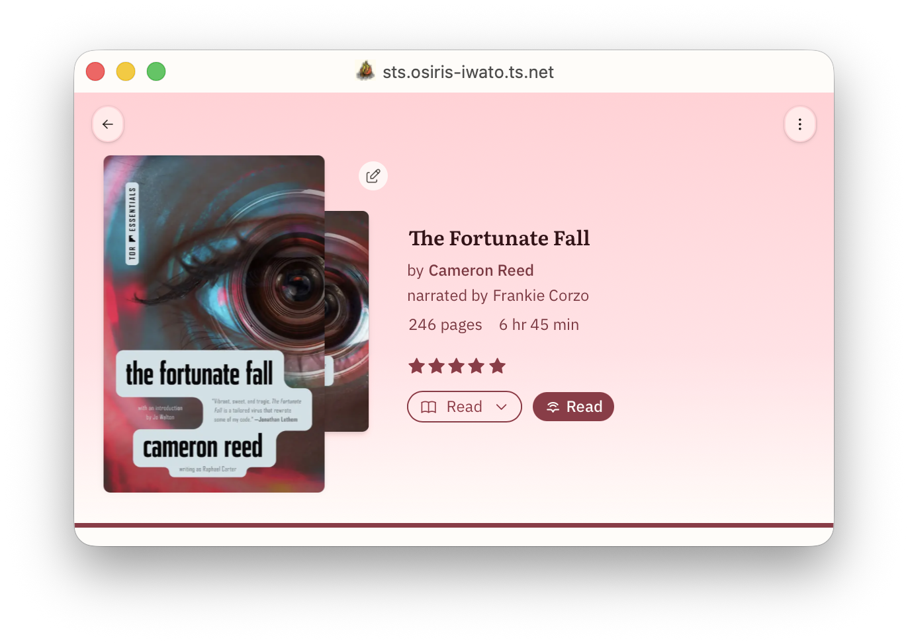

So, we now have the ability to rename those however you want. You can change "To
read" to "TBR", you can change "Read" to "Finished". Whatever floats your boat.
But those three statuses have special behaviors and those behaviors are
immutable.

Namely:

- Books in your "To read" list, show up the the special homepage list "Start
  Reading".
- Books in your "Reading" list, show up in the special homepage list "Currently
  Reading". Also, when you start reading a book that was on your "To read" list,
  it will automatically move to your "Reading" list.
- Books in your "Read" list will show up in the special homepage list
  "Completed". Also when you finish reading a book in your "Reading" list, it
  will get automatically moved to "Read" once you have completed 98% of the
  text.

So this is great, but I have 2000 books and a _family_ server. We are a family
of readers with widely divergent reading tastes. What if I want a book to have
**_no_** status? What about what about other statuses? Well, we accommodate
those now, too!

Personally, I have three of them: DNF (abandoned / did not finish), Not for Me
(don't show me this; I don't want to see it ever), and On Pause (soft DNF, but I
may come back to it later). You might have others. The important thing to
understand is that all statuses are **mutually exclusive**. A book can only have
one status (or no status at all).

If you are running a personal server, you might rightly just want the three
statuses and for anything new to come in as TBR. EZ PZ.

But... if you are running a family server, I would suggest setting the default
status to "none". Then your library is like a _real library_. Your family and
friends can see the collection (whichever collections you allow them to see) of
books and they can peruse **Recently Added** books and then add the books into
whatever personal status work for them!

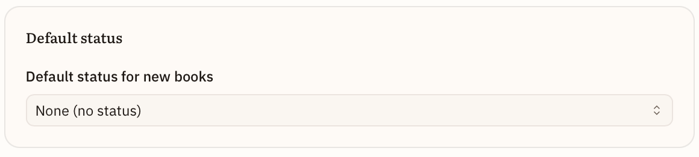

They can even choose, if they want, to override the "none" status and have every
new book come into the status of their choosing.

Now that I am thinking about it another good status for incoming books might be
"Review". Then you and your users would know these are new and should be
reviewed to be sorted into the correct status. I just might add that!

The point is that you can figure out a status system that works for your
Storyteller library and label them however you want.

Eventually, I would love these statuses to be syncable to GoodReads (Want to
Read, Currently Reading, Read, Paused, Did Not Finish, make-your-own), Hardcover
(same but without make-your-own), or The Story Graph (read, paused, did not
finish, to read). But that is obviously down the road...

Anyway, I think Storyteller has pretty much nailed Statuses. I hope you agree!

## Personal Ratings and Reviews

I am not sure this really counts as "how I organize my bookshelves", but I am
going to wedge it in here because 1) it is cool, and 2) you can use ratings and
reviews to create shelves....

Storyteller now lets you keep track of your personal ratings and add your
personal review. I am optimistic that one day we will be able to sync this data
with Hardcover at least, and maybe someday with Goodreads and/or The Story Graph
as well.

Regardless, what we _do_ have that no one else has is our multi-dimensional
scoring system which was created by Thomas and adapted from my daughter, the
book-tokker's personal rating system which she describes here:
https://www.tiktok.com/@bookgabber/video/7579768390781340983

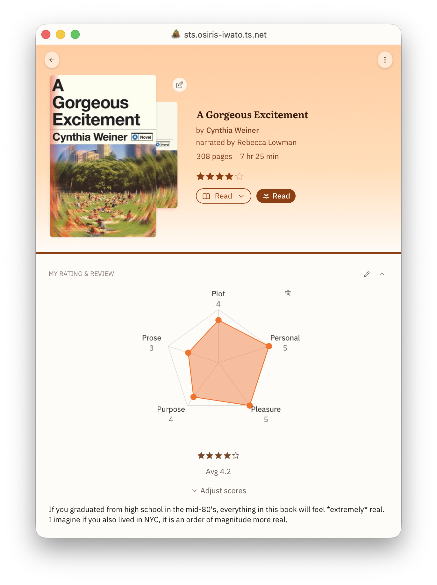

When you have that book where you just can't decide what the score is, the
multi-dimensional scoring can really help! And you can customize the points (and
even the number of points) however you want.

And then you can use that data to make smart shelves...

## Tags and Metadata

I went back and forth about whether I should talk about **Tags and Metadata**
first or **Collections and Shelves**. I chose tags and metadata because shelves
can depend on them.

As I mentioned, I previously managed all my books with Calibre. Calibre has
decent metadata importers, and we are working hard to get metadata importers of
our own up and running. We are not trying to be the premiere metadata
reconciliation app in the space, but we will have basic importers soon. We
recognize that many of our users are going to depend on other apps to perform
this function precisely the way they want. And we are fine with that.

I am going to focus more on which bits of metadata are — in my opinion —
valuable and how Storyteller handles them and _why I love it_. And in the next
section, I will talk about how I harness them to make really powerful shelves.

Warning: this section is a bit chaotic. And maybe a wee bit pedantic. But bear
with me. It will help to understand all these things when we talk about
shelves....

### Title and Subtitle

This doesn't actually have anything to do with shelves. I just personally love
it.

Most apps / systems do not have a dedicated field for subtitle. So you get
titles like this:

Life Lessons from a Parasite: What Tapeworms, Flukes, Lice, and Roundworms Can
Teach Us About Humanity's Most Difficult Problems

That... is not a reasonable title....

Storyteller gives you a dedicated subtitle field so that when you showcase your
books, they look beautiful, like this:

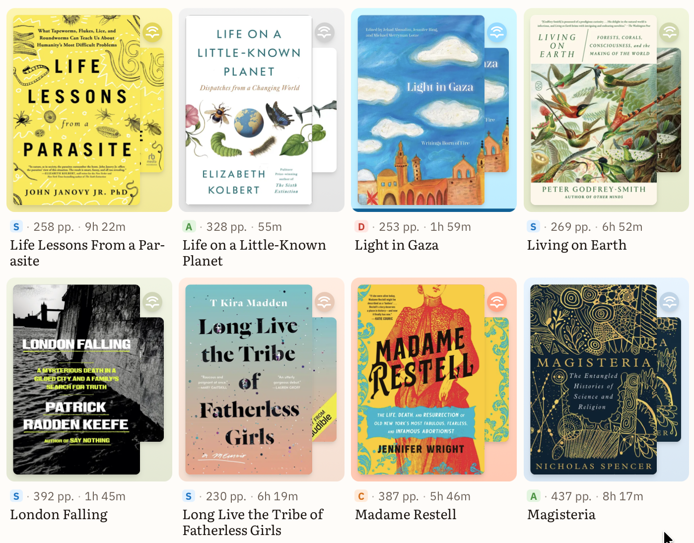

Just look at some of those subtitles. So loooooong.

I _love_ a nice clean data set and an easy-to-access subtitle field can be
leveraged well to make presentation of your books nice and clean. And when we
get editions (a future feature), subtitles will become even more important!

### Authors, Narrators, Translators, and Other Contributors

Storyteller not only keeps up with your authors and narrators, but it is
uniquely strong at keeping up with other creators and contributors to your book
as well!

Have several different versions of a classic with different writers of the
introduction or forward? We got you.

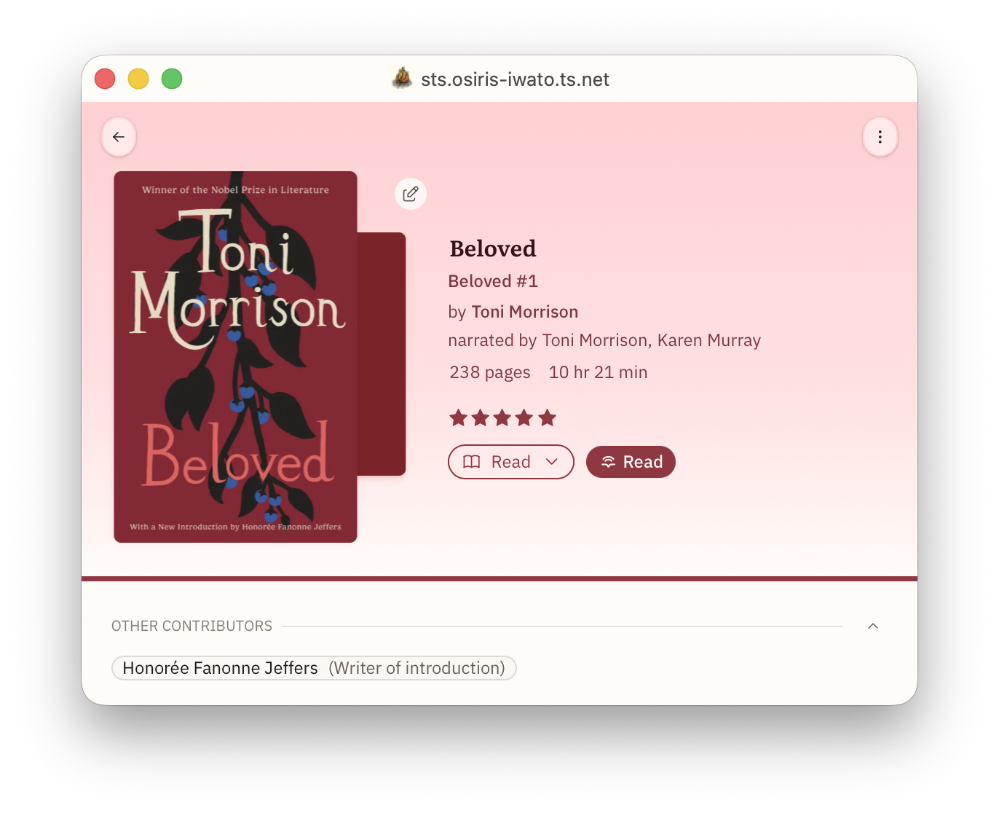

Perhaps you care deeply about illustrators; you can curate that information
easily in Storyteller. Whatever contributors you care about, you can keep track
of them.

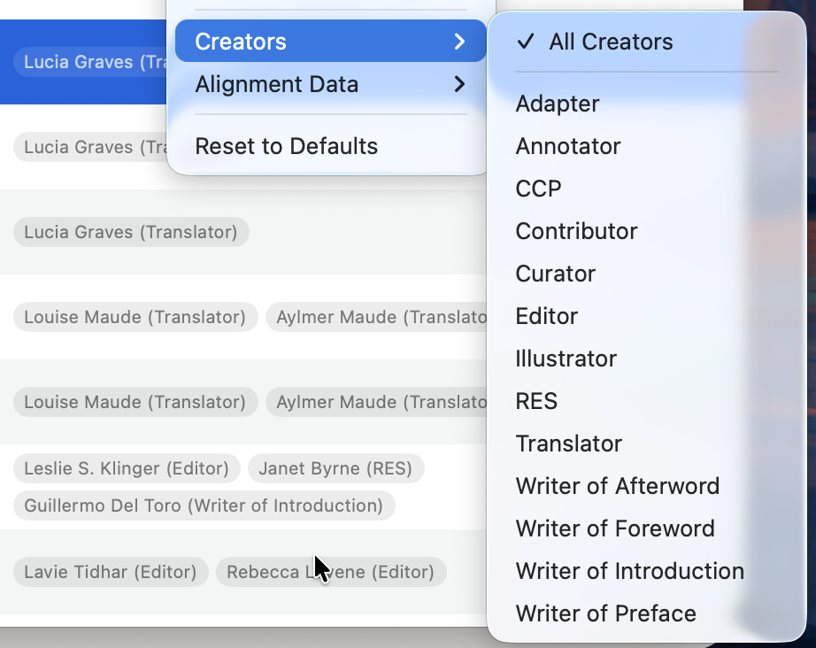

#### Translations

I do want to spend a minute talking about translations in particular....

When I was first working on aligning my books, I lost _hours_ (days?) trying to
align audio and text for Anna Karenina. I could not understand what was going
on.... I had the great Maggie Gyllenhaal narration from Audible, and the ebook
with the purple hydrangeas on it that was the really popular one from Oprah's
book club. These were both purchased media that should not have any issues. What
was wrong??? I tried tiny.en, I tried large-v3-turbo. More than once. Fail.
Fail. Fail.

It was the translation.

The Oprah book club is the relatively recent Pevear and Volokhonsky translation
and the Gyllenhaal narration is the Constance Garnett (copyright-free)
translation!

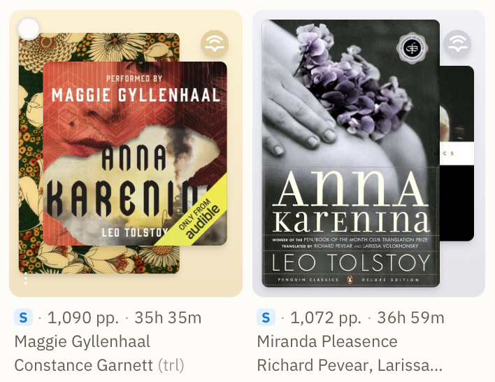

Once I got the correct ebook-audiobook pairs, you can see they aligned
beautifully! (That is what that **S** represents.)

I have **_FIVE_** different translations for Siddhartha. And I truly have a
reason for keeping each one!

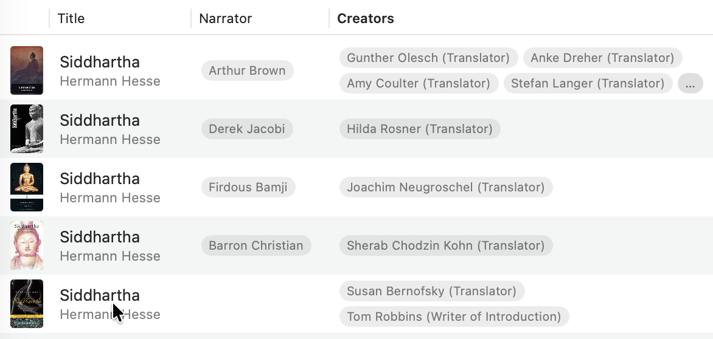

Because tracking translators is critical to good alignments, you can elevate
translators to the same level of importance as authors and narrators in
Storyteller's left navigation bar.

I am pretty sure that at the moment, Storyteller is the only app that surfaces
this, and _trust me_, if you are aligning books that are translated, you
_absolutely_ want to check that the translation of your ebook and audiobook
match, _especially_ for classics... (See https://welovetranslations.com)

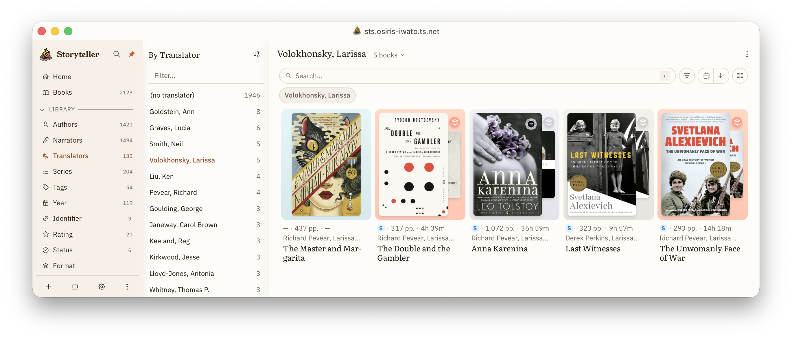

### Series

You would think Series would be easy. Lolol. You sweet, sweet, summer child!

For a lot of books, it is pretty straightforward. There is a trilogy. It is
three books (unless it is _The Hitchhiker's Guide to the Universe_). They were
published in order. They are chronologically in order. Done. Finito. End of
story. (Pun intended.)

But you have other series that have a publication order, a different in-universe
chronological order, and perhaps a recommended first reading order — which could
be different from both (Vorkosigan Saga)! Then you have books that are
cross-overs and exist within two (or more) different series (The Cosmere). Or an
overarching series and sub-series (The Realm of the Elderlings / The Farseer
Trilogy). Or maybe you have two narrations of the same ebook in a series and so
you need to have 2 books at the third position (The Wheel of Time —
Kramer/Reading vs Rosamund Pike).

Or maybe you want to make your own ordered series.... _Jess's recommended
reading order for Toni Morrison's Novels_. That could be a series! Why not?!

Storyteller accommodates _all_ of that. It allows you to add a book to as many
series as you want, designate one series as the _primary_ series, and put as
many books at a single position as you want.

Series _nirvana_. ;)

### Publication Date

We still have work to do here and publication date is going to get a lot more
precise in v4 when we transition to a works-edition model. But for now, the
publication field should be used for the _original_ publication date of the
work.

Eventually, we will be adding release dates to both ebooks and audiobooks so
that particular editions can be differentiated. This is especially valuable for
audiobooks, but is useful for ebooks as well.

### Identifiers

The most widely understood identifier for any book is the ISBN. Books used to
have ISBN-10 IDs, but generally we use the ISBN-13 to find books. These days,
there are many other identifiers that are commonly used — a lot of
self-published books don't even have ISBNs, but you can still buy them on
Amazon! Those super popular Emma M. Lion books are self published for instance.
And then of course, each online book-tracking app has their own identifiers as
well.

Storyteller supports finding, storing, and using these identifiers. If your
ebook or audiobook has identifiers in the metadata, Storyteller will extract
them for you. For identifiers that Storyteller already understands, those
identifiers are automatically used to link you to external sources of
information about your book.

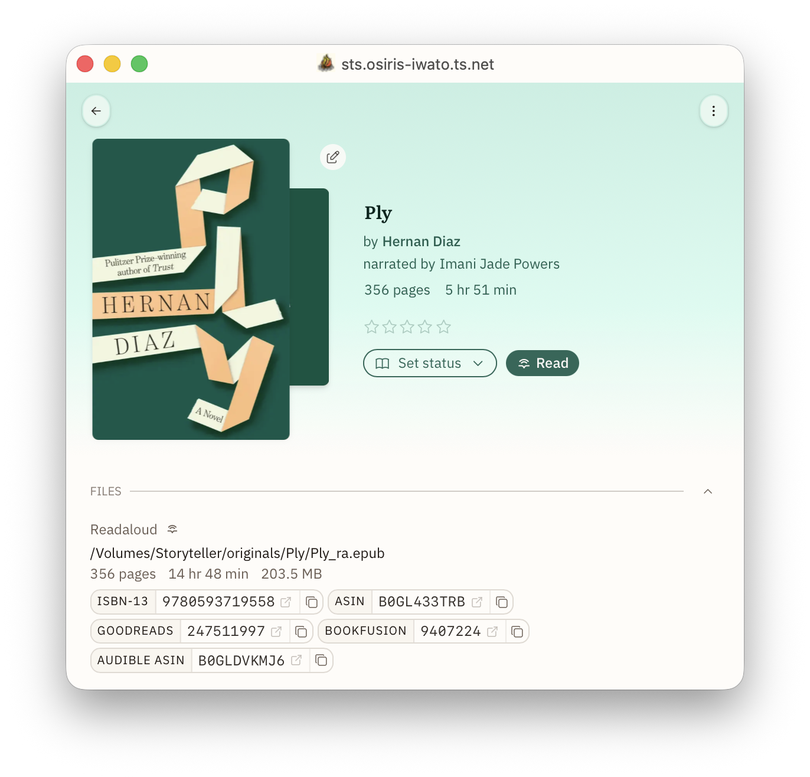

Storyteller natively has the following Identifiers:

- ISBN-13 which takes you to isbnsearch.org
- ASIN which takes you to Amazon
- Audible ASIN which takes you to Audible
- DOI which takes you to **???** IDK actually becuase I don't have any books
  that use DOI, but the academics in your life will be happy about this.
- Hardcover book slug which takes you to the Hardcover page for a work
- Hardcover edition ID which takes you to the Hardcover page for a specific
  edition

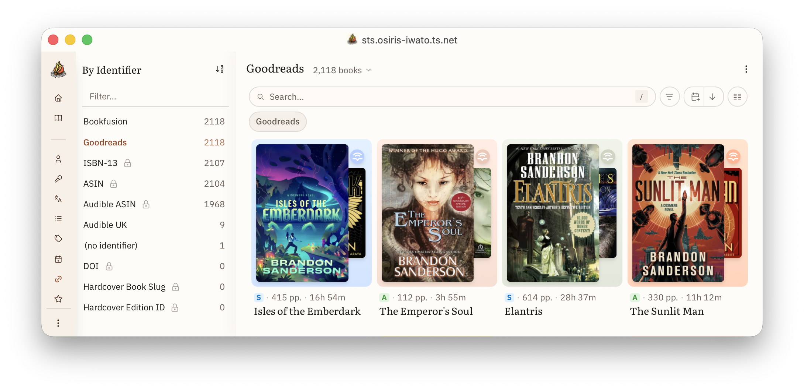

You can also add your own identifiers and generate correct URLs for those, too!
For example, if you want to add Goodreads IDs, the URL is:
`https://www.goodreads.com/book/show/{value}`. I hope one day, we will have the
ability to actually sync with Goodreads, so personally I do keep these properly
updated.

I also still have a BookFusion account (for now), and clicking on that link
takes me right to my copy of the ebook in BookFusion!

### Tags (aka Subjects aka Genres aka _Whatever you want them to be_)

And last we come to tags.... or subject or genres or
some-other-bits-of-metadata-I-want-to-stick-to-books-but-Storyteller-doesn't-have-a-dedicated-system-for-it-how-dare-they-not-have-something-that-works-exactly-the-way-I-want-it-to-where-is-my-facet-for-prize-winners-where-is-my-facet-for-moods???

Libraries call them subjects. Goodreads calls them Genres. Hardcover calls them
Genres, but also has a separate one called Moods and another for Content
Warnings, but also also sometimes one of the tags will be something like "F" or
"hamburger"... TSG avoids it by just having a little picture of a tag but they
are different colors, so I think it is genres and moods?

Who knows; it is very confusing. We have had looooong debates about this and
here is where we have landed at Storyteller: we used to call these "Tags" but
for reasons that will become clear later\*, we are moving to calling these
"Subjects" as a better term to be used for this particular purpose.

Once our metadata importers are up and running, Storyteller subjects will match
to Hardcover tags (which are truly a bit chaotic right now) and Audnexus tags
(which are a bit cleaner) for the purpose of importing metadata.

Tags/Subject/Genres/Moods are highly personal, and everyone needs to come to
their own unique system. But this post is about **_meeeeee_** and what I think
is best. So, here is what I do.

I have 2000 books and 54 subjects. When I import a book that has tags in it, I
just immediately delete tags that are not part of my core 54.

For example, I have a tag for Gothic & Horror because neither are really big
genres for anyone in my family, and I feel like the Venn diagram for these is
mostly a circle..? In any case, I do not want to spend any time contemplating is
something gothic, horror, or both? That said, books usually come in as just
Horror. So I add them to Gothic & Horror and delete the Horror subject whenever
it gets created. (I do eventually want a metadata plugboard where I can just
tell Storyteller: if Horror or Gothic, then Gothic & Horror, but that is also a
very post-v3 proposition)

I have Religion & Spirituality as a big catch-all, because again, it is
generally not my genre, but then I also have categories for Jewish and Buddha
because we are Jewish and one of my children is a Buddhist, so we have a lot of
books about Buddhism.

Also, I have a non-fiction subject, but not a fiction subject. IDKY I do it that
way, but it works for me!

If you care about content warnings, maybe you make a bunch of subjects that are
like CW\: CSA, CW\: SA, CW\: violence. Maybe you care about moods. You could do
the same for that with a prefix or just intercalate them in there. You do you.

Which subjects you have in your library is mostly _personal_. Just make sure
your subjects work for you. Usually, this means stripping out a bunch of
garbage.

So, I have spent a lot of time advocating for personalizing how you view
Subjects, but there is one other important consideration...

Subjects are a _library_-level designation. Like title, author, pub date,
subjects will appear to all users of the library. So using subjects like
"favorite" or "re-read" are not recommended unless you are the only user of your
library. In which case, be free!

My recommendation is to stick to subject that are more library and genre-like
here, but within that framework, pick ones that actually work for you and are
reflective of what your library actually looks like. Get rid of any subject that
has fewer than 3 books. You can always add one back if you suddenly become
obsessed with books that take place in Greece and want a subject for that!

\* We _are_ planning to eventually institute _tags_ for personal use (or maybe
we decided to call them labels? I can't remember. They will be one or the
other). This would be where you would be able to label books with personal
qualities that would not be shared library wide. In the interim, you can always
create a shelf....

## Collections and Shelves

Okay! Now you understand a bit about metadata and how to curate it at the
library level. But why bother? What do you do with all this nice clean
information about your books??

You use it — to make your library powerful by creating collections and shelves.

Collections and shelves are confusing to most people when we first start talking
about it. It took a long time to really hammer out our understanding of them,
why we have both and how they differ, so please bear with me a bit as I try to
help you understand the differences between collections and shelves, and between
smart shelves and static shelves.

First, fundamentally, collections and shelves are just lists of books. That is
it. A list of books.

But...they each have special properties!

### Collections

Think of collections exactly like your local library collections. Your library
may showcase a group of books to their users on their home page. Every user of
the library sees the books in that collection. This image is from the Libby
homepage for Maryland's digital library showcasing their new biography titles.

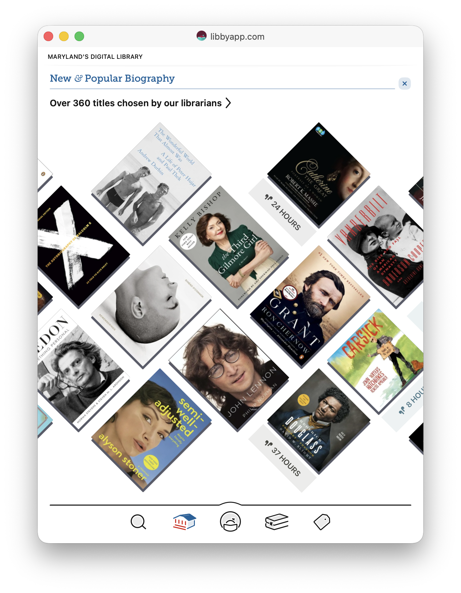

But like Harry Potter, there may also be a "Restricted Section" where only some
patrons are allowed to see the books. I live in Louisiana where a new law
requires libraries to age-restrict books (mostly those on LGBTQ+ themes).
Hopefully that is _not_ how you will use your librarian powers. I hope you are
only restricting your boss or grammy from seeing your vast dragon-porn
collection. (At Storyteller, we are 100% judgement-free. You should read
whatever floats your boat!)

Regardless, you can use collections for both of these purposes.

- To restrict access to certain books for certain users, or
- To highlight a cool set of books for all your users to see.

A **collection** is a library function.

This means

- A public collection (and all the books therein) is viewable by all users of
  the library.
- Only users with special permissions can create or delete collections.
- A private collection can only be seen by users given access to that
  collection.
- If a book exists only inside a private collection, it can only be seen by
  users with permission to view that collection. If the book is also in a public
  collection, it will be visible to everyone.
- You can set up a watch folder to deliver books automatically into a particular
  collection.

When creating a collection, you can add a description and select a custom icon
out of a list. (Eventually, we plan to add the ability to add your own .svg
icons as well as the ability to select a default order for each collection —
right now they all default sort by date added.)

Here are some examples of my collections:

- Pulitzer : this is exactly what it sounds like. I put every book that won a
  Pulitzer or was a finalist in this collection.
- NYT 100 : books I own that are on this list:
  https://www.nytimes.com/interactive/2024/books/best-books-21st-century.html
- Pride 2026 : a list of good LGBTQ+ books that people might want to read. I
  made collection during June this year. Sadly, I accidentally set it to private
  -- which made it so none of my family could actually see the shelf _or any of
  the books on the shelf_ for the entire month. 😫 So make sure your set your
  permissions to _public_ if you are creating a collection to showcase to all
  your users!
- No audio : these are my ebooks without a known professional audiobook
  recording.

So as you can see, I mostly use collections to highlight books that I want to
promote to everyone on my server. (_No audio_ is the exception, and I will
discuss how I use it to create a particular smart shelf below.)

This is fun! I love making collections to share with my family!

But what about my own personal collections? The ones that are just for me...? Or
my daughter — who has over 50 shelves on Goodreads... I love her dearly. I do!
But I do not want to deal with all 50 of those collections when I am using
Storyteller! She will want to keep up with and organize the books in our family
library in her own way, too, though... Hmmm....

### Shelves

So in Storyteller v3, we now have **_shelves_**. Shelves are personal (private)
lists that every user has the ability to create. We have two classes of shelves.
Static shelves and smart shelves.

**Static shelves** are just like collections, but the are private and all users
can make their own. Like collections, you can select any random assortment of
books to include in the shelf. You can call it whatever you want, give it a
little description, and pick a cute icon for it! These shelves are static. Other
than deleting the book, no changes to the book or metadata will remove the book
from the shelf unless you remove it yourself.

Static shelves are great for keeping track of things like "Go-to books to
recommend to others" or "My favorite books of all times" or "Books I maybe want
to read again" or "Books recommended to me by Aunt Helen". Basically, books with
some ineffable quality that cannot be captured through other means.

I have currently only have one static shelf. It is called "Editions", and it is
where I keep track of all my books that will eventually be an issue when we move
to a new book model. So whenever I have two narrations or translations for the
same book, I put it in my editions shelf.

But I feel pretty confident that my daughter will be a big user of static
shelves because she literally has over 50 shelves on Goodreads. I wasn't
exaggerating.

For me though... the powerful tool — and what all this has been leading up to —
are smart shelves.

**Smart shelves** allow you to use all that fabulous metadata you worked so hard
on and make shelves _that keep themselves current_ at all times!

Here are a few of my smart shelves:

- Multi-series : books in more than one series
- Multi-author : books with more than one author
- Late last century : Books first published from 1967 to 1999 (because why not?)
- Award winners : Any book where I have listed an award in the description (I
  have a very hacky way of doing this — one that requires pristine descriptions,
  but it works for me... ;) )
- Unread classics : books that are on my TBR **_or_** have no status **_and_**
  have a publication date < 1966 (if it is older than me then it is a classic ;)
  )
- Missing Audible ID : audiobooks without an Audible ID (these are usually older
  books or books that I acquired in the UK that are not available in the US)
- Missing IDs : ebooks missing either ASIN or ISBN. (I told you I was OCD...)
- Translations : all books with a translator (I learned my lesson and do not
  want to have to go through _that_ again!)
- Missing Matchbook : these are my books that should be align-able at some
  point.... ebooks that are not in the No Audio collection but don't have
  audiobook yet, audiobook where I don't have ebook yet, and books where I have
  both, but have not yet created the readaloud or the readaloud has failed to
  align.

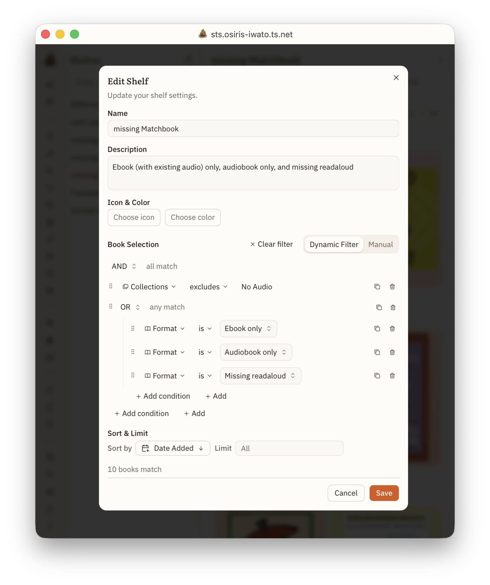

But let your imagination go wild. How about:

- Multi-cast recordings : audiobooks with more than 2 narrators
- My most recent 5 star reviews : last 10 books you rated 4.5 or higher
- Unread Sanderson : all books by Brandon Sanderson that are not marked read
- Unread "SHORT" Sanderson : as above, but less than 500 pages
- New quick reads : less than 150 pages or 2 hours published since 2024 or added
  in last 6 months on my TBR or no status
- Beautiful old books : published before 1980 and Prose rating = 5

You get the idea... You can use all the different facets to create whatever
kinds of dynamic shelves work for you!

Eventually, we want to find a way that you _can_ share your shelves (or shelf
formulas) with people on the same server or maybe even export them as list as
well. _Post-v3, post-v3, post-v3..._

### Then what?

Then you organize it all however you want and put your favorites on your
homepage!

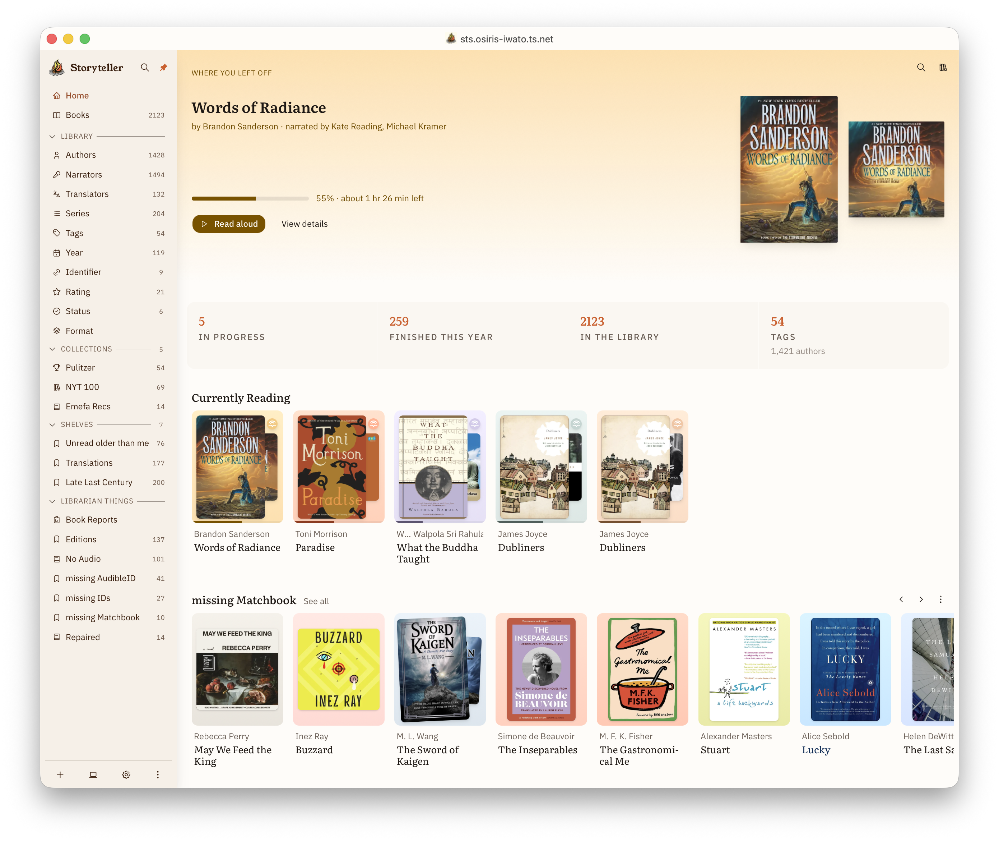

### Tl;dr

Collections and shelves are lists of books. Collections are essentially
library-wide where as shelves are private. Shelves can be static (a selected set
of books) or dynamic (filter-based).

## Jess's Library Management Wish List

So...

I think there is nothing out there that compares to Storyteller for being really
thoughtful about how you organize and share your books and love of books. We
aren't trying to be everything for everyone, but we are trying to be the go-to
for reading and sharing your books in a really lovely and flexible way.

A few items on my wish list will not be in v3, but they are at least in
discussion. Some should be coming soon after v3, and some may not come around
until v4.

Very briefly (and in the order I think they will show up):

- **Syncable highlights** : these are a pretty big priority, and I expect these
  to land pretty shortly after v3.
- **Personal tags** : these will probably arrive with or very shortly after
  syncable highlights as they are pretty entwined with our vision of top-shelf
  highlights.
- **Personal reading stats** : we get a lot of requests for this, and it is just
  a matter of getting v3 out the door first. I feel confident we will have at
  least some basic stats soon-ish.
- **Micro-community** : I actually have no idea when this will land, but sharing
  shelves, sharing personal stats and progress, and buddy reads with shared
  highlights are some of our ideas here.
- **Work-Editions** : my personal white whale. I think this is v4. But even if
  it never happened, I am so, so happy with Storyteller, and I hope you are too!

\~fin\~
