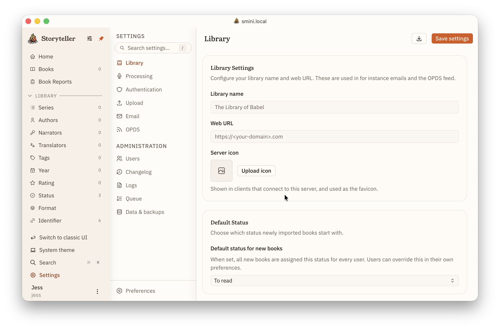

I am stealing this page to learn how to use this and to stuff images and to
start to outline stuff. Probably first and second order titles will eventually
be their own pages and sections.

# The Storyteller Server

The Storyteller server is managed through a web browser and can be accessed
according to how you initialized it in Docker. Generally, it can be reached at
http://localhost:8001 .

## Creating your library

### Creating an admin user

`Note: This screen needs to have "Full Name" updated to say "Display Name"`

When you open Storyteller for the first time you will see a collapsed library
browser on the left side and the homepage in the main window. The library
browser can be pinned so that it stays open at all times or it can open whenever
you hover over it to maximize your main window.

The home view can be customized in many ways to suit your personal preferences
once you begin adding and reading books.

Before you go any further though, you should take a look at some of the basic
settings and make decisions about how Storyteller is going to handle your files.

### Settings to review before importing your first book

#### Library settings

While not strictly necessary, if you have any intention of sharing your library
with others, you should fill out the information under Library Settings. This
will make it so that your users can see your library name and/or icon and when
the invitation is created, they will have a URL that they can click to get
directly to your instance.

#### Default status

If the library is for your use alone, you will want to set this according to
your own preferences. Are most of the books you are importing already read? Are
most unread? Would you prefer to decide later? This can be changed at any time.
_But_ whatever you select here will also be the default for any other users you
may add. If you know you will have more than one user, we recommend that you
choose "None (no status)" as the default status.

#### Auto-importing

`Note: I think big changes are happening here...? need to change backup & rename to Rename epub2, change convert & rename to Rename epub3, change Replace in place to just Replace v3... Awaiting update to get screenshot and describe`

#### Library scanning

#### Meta-data handling

# The Storyteller Apps

Storyteller now has the following apps: Android (with Android Auto), iOS (with
CarPlay), watchOS, tvOS, and macOS. Storyteller can, of course, also always be
accessed via any web browser.

`Provide appropriate app store links.`

## The Mobile Apps

As much as possible there is exceptional parity between the apps so for the
purposes of these documents, iOS app images will generally be used.

### Managing the app

#### Logging in for the first time

#### Settings

#### View options

### Managing the Library

#### Home Page

#### Filtering by facets

#### Metadata management

#### Readaloud creation

### Managing the Reader

#### Global reader settings

`These are pretty standard. Can go quick`

#### Readaloud settings

`Need to explain all of these. Most people will not have thought about these things.`

#### Themes

`Explain dynamic themes`

#### Complications

The menu bar (top of the reader), the dock (bottom of the reader), the mini
player _and_ the full audiobook player are _all_ customizable with different
statistics and complications.

`EXPLAIN. Lots of screenshots. List and define all complications and stats.`

## Additional Apple Apps

### macOS

The mac app includes all of the functionality of the mobile app and as well as a
couple of macOS specific enhancements (left drawer)

`If mobile is done correctly, this section can mostly be used to highlight Mac-specific features`

### watchOS

`Need to explain the two different ways of reading on watchOS

### tvOS

`Need to go through settings and limitations`

## The Storyteller Web Reader

`Probably not a lot of changes here`

## OPDS Feed

`Ditto`
